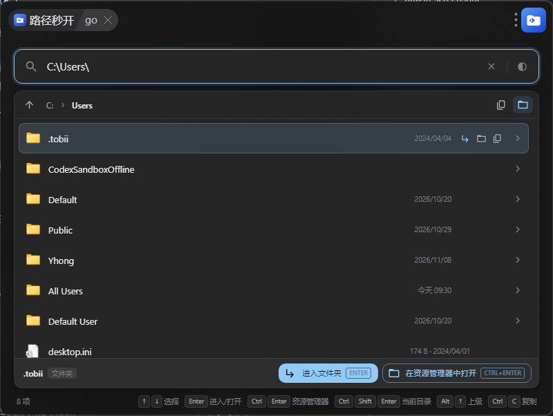

# 路径秒开（path-jump）

> 一个 uTools 插件：输入或粘贴路径，逐级浏览并直接打开文件与文件夹，可从任意文本中智能提取路径。

**已在 uTools 插件市场发布 —— 在插件市场中搜索「路径秒开」即可安装使用。**

<p align="center">
  
</p>

## 解决什么问题

你大概遇到过这些场景：

- 复制到一段路径，却要打开资源管理器，一级一级双击进去；
- 报错日志里写着 `Cannot find module 'D:\project\src\index.js'`，只想直接跳到那个目录看看；
- 有个路径带空格、带引号、末尾还跟着一句中文说明，粘贴进地址栏直接失效。

这个插件把「路径 → 打开」压缩成一次输入。它不要求你把路径输得干净，而是尽力去理解你输入的东西。

## 功能特性

**双入口**

- 在 uTools 输入 `go` 回车，进入逐级浏览模式；
- 任何地方选中或输入含路径的文本，uTools 候选列表会出现「路径秒开」，回车直接跳转。

**智能路径提取**

自动从自然语言中剥离路径，处理好这些干扰：

| 输入 | 提取结果 |
| --- | --- |
| `详见 D:\文档\报告.pdf。` | `D:\文档\报告.pdf` |
| `"C:\Program Files\App"` | `C:\Program Files\App` |
| `（~/Documents/note.md）` | `~/Documents/note.md` |
| `D:\My Project\src index.js 报错了` | `D:\My Project\src` |

**四级容错定位**

即使路径不完全存在，也会尽力带你到最接近的位置：

| 级别 | 策略 | 适用场景 |
| --- | --- | --- |
| 1 · `exact` | 直接探测 | 标准完整路径 |
| 2 · `trim` | 剥离尾部标点/句号后重试 | 句末带标点 |
| 3 · `token` | 从尾部分词逐段剥离后重试 | 路径后跟了参数 |
| 4 · `walk` | 回溯到最近存在的祖先目录，剩余片段转为筛选词 | 中间某段拼错或已被删除 |

**其它**

- 逐级浏览，面包屑可点击回跳，`Alt+↑` 返回上级；
- 列表按「精确 > 前缀 > 包含 > 模糊子序列」排序，文件夹优先，中文与版本号自然序；
- 显示系统原生文件图标、文件大小与修改时间；
- 起始页快捷入口支持自定义：默认列出盘符、主目录与桌面，可增删或一键恢复默认；
- 浅色 / 深色 / 跟随系统三态主题，持久化保存；
- 全程键盘操作，双手不离主键盘区。

## 安装

### 方式一：插件市场（推荐）

在 uTools 中打开「插件应用市场」，搜索 **路径秒开**，点击安装即可。安装后输入 `go` 唤起，建议同时为其设置一个顺手的全局快捷键。

市场版本可自动更新，日常使用建议选这一种。

### 方式二：从源码构建

适用于参与开发、或想查看某个版本的实现：

```bash
git clone https://github.com/YongHangPu/path-jump.git
cd path-jump
pnpm install
pnpm run build
```

然后在 uTools 中开启开发者模式，用「uTools 开发者工具」新建项目，选择 **`dist` 目录下的 `plugin.json`**。

> 注意必须选择 `dist/` 而不是项目根目录——`plugin.json` 需要与构建生成的 `index.html`、`index.js`、`preload.js` 位于同一目录。

## 使用

<p align="center">
  
</p>

### 快捷键

| 快捷键 | 作用 |
| --- | --- |
| `↑` `↓` | 在列表中移动选择 |
| `Enter` | 进入文件夹 / 打开文件 |
| `Ctrl`+`Enter` | 在资源管理器中打开文件夹，或显示文件所在位置（macOS 为 `⌘`+`Enter`） |
| `Ctrl`+`Shift`+`Enter` | 在资源管理器中打开当前所在目录 |
| `Alt`+`↑` | 返回上一级目录 |
| `Ctrl`+`C` | 复制选中项路径（输入框内无选中文本时生效） |

### 典型用法

**一次直达**：直接输入完整路径回车。

```text
C:\Users\Public
```

**逐级浏览**：输入 `C:\` 回车，用 `↑` `↓` 选中文件夹，`Enter` 进入。

**从报错信息跳转**：把整段日志粘进 uTools 输入框，候选列表里选中「路径秒开」，直接跳到 `D:\project\src\`。

**拼错的深层路径**：输入 `D:\project\src\componets\Button.jsx`，若 `componets` 实际不存在，插件会停在 `D:\project\src\` 并把 `componets` 作为筛选词，你只需继续输入正确名称。

## 工作原理

渲染层不直接接触文件系统，所有本地能力由预加载脚本以 `window.services` 暴露，一层 `fs` 调用、一层纯函数、一层视图：

| 模块 | 职责 |
| --- | --- |
| `bridge/preload.js` | 暴露 `resolveQuery` / `openDirect` / `openPath` / `revealPath` / `copyPath` / `getQuickLinks` / `getPlatformInfo` / 主题读写；实现四级容错定位 |
| `bridge/path-utils.js` | 纯函数：路径提取、归一化、去噪、父目录、面包屑分段 |
| `src/App.jsx` | 状态机、键盘绑定、防抖与竞态控制、主题切换 |
| `src/components/` | `PathBar` 面包屑、`EntryList` 列表、`SelectionBar` 选中操作栏 |

`resolveQuery` 返回统一结构（`mode` / `baseDir` / `filter` / `entries` / `segments` / `upDir` / `notice`），由六个状态（`browse`、`search`、`target`、`resolved`、`invalid`、`error`）驱动全部界面表现。

## 目录结构

```text
path-jump/
├── bridge/
│   ├── preload.js        # uTools 预加载脚本，Node 侧能力
│   └── path-utils.js     # 路径处理纯函数
├── src/
│   ├── App.jsx           # 应用状态机与交互
│   ├── components/
│   │   ├── PathBar.jsx
│   │   ├── EntryList.jsx
│   │   └── SelectionBar.jsx
│   ├── enterBus.js       # 接收 uTools 插件进入事件
│   ├── utils.js          # 大小与时间格式化
│   ├── styles.css
│   └── index.js
├── public/               # 构建时整体复制到 dist
│   ├── plugin.json       # uTools 插件清单（命令与正则入口）
│   ├── index.html
│   └── logo.svg / logo.png
├── plugin-screenshot/    # 界面截图
└── webpack.config.js     # 双构建：preload（electron-preload）+ 渲染层（web）
```

## 开发

```bash
pnpm install
pnpm run dev     # webpack watch，持续输出到 dist
pnpm run build   # 生产构建
```

技术栈：React 19、MUI 9、Emotion、webpack 5 + Babel。`dist/` 为构建产物，不纳入版本控制。

## 已知限制

- 仅在 Windows 与 macOS 声明支持；代码中包含 Linux 分支，但未做完整验证。
- 单个目录最多显示 300 项，超出部分需继续输入以缩小范围。
- 列表未做虚拟滚动，超大目录的全量渲染会带来轻微开销。
- 依赖 uTools 运行环境；直接用浏览器打开 `dist/index.html` 只能看到界面，本地文件能力不可用。
